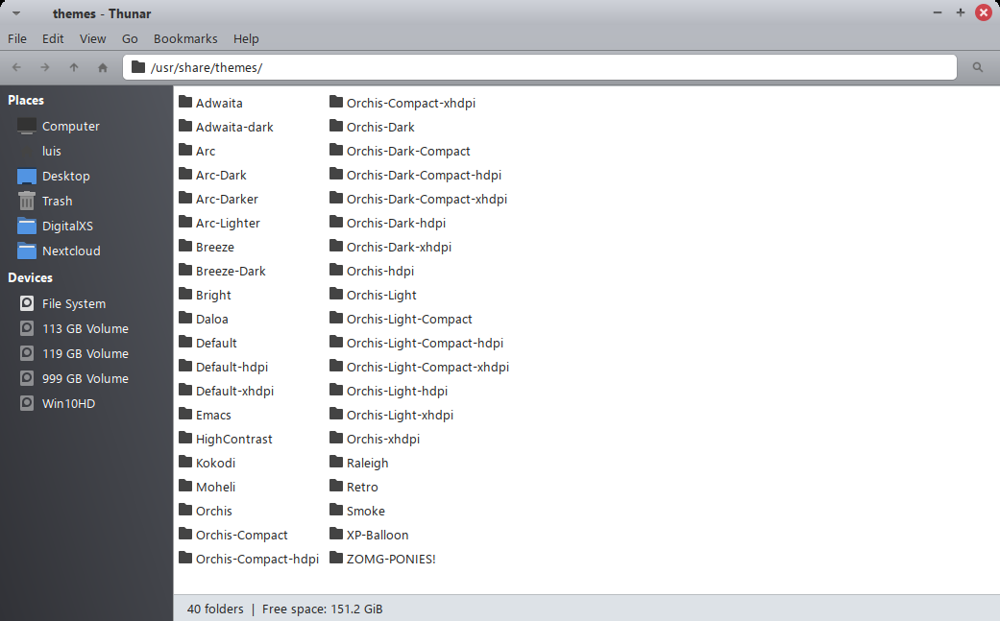
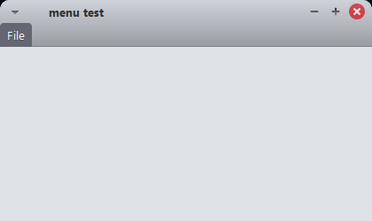
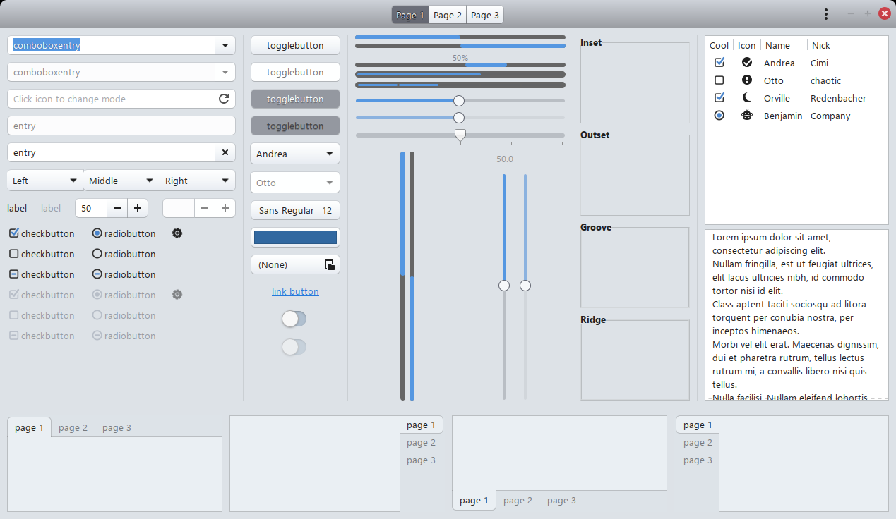
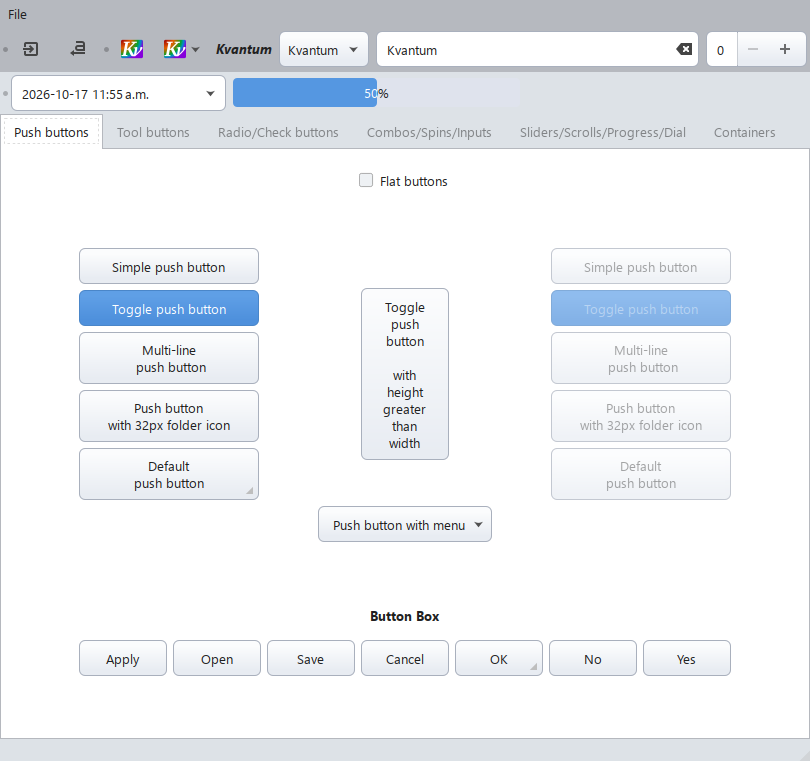

# NewPro-XFCE

A professional GTK/XFCE theme for the XFCE desktop, with a matching Kvantum
theme for Qt apps.



## What's new in v2.3

- **One rounded-corner scale** everywhere: 6px buttons, entries, tooltips and
  rows; 8px menus, popovers and frames; 10px window tops (bottoms stay square). Linked button
  groups keep square inner edges, maximized windows stay square.
- **Rounded menus**: dropdowns from menu bars and the panel round every corner
  except the top-left, which sits under the menu item. The menu bar highlight
  itself has very slightly rounded (4px) top corners.
- **Rounded window tops** (10px) drawn by xfwm4 itself, regenerated by
  `tools/make-corners.py`. Window bottoms stay square.
- **Panel styled like Thunar's menu bar** — same grey, same text colour, same
  slate highlight — with slightly rounded bottom corners. Works in the panel's
  dark mode too.
- **Distro logo** for the menu button, picked automatically (see below).
- **Kvantum theme** for Qt5/Qt6 apps (see below).
- **GTK4 dark variant fixed** — it previously had no widget styling at all.
- CSS parse errors fixed (no more GTK warnings on every app start).
- Defaults: Papirus icons, Bibata-Modern-Ice cursor.

| Menus | Widgets |
|---|---|
|  |  |

## Compatibility

- **XFCE**: 4.20.x
- **Debian**: 13 (Trixie)
- **GTK**: 2.0, 3.24, 4.x
- **xfwm4**: 4.20.x

## Theme components

| Directory | Description |
|-----------|-------------|
| `gtk-2.0/` | GTK2 legacy theme (requires `gtk2-engines-murrine`) |
| `gtk-3.0/` | GTK3 theme (`gtk.css` light, `gtk-dark.css` dark variant) |
| `gtk-4.0/` | GTK4 layer — `gtk.css` (light), `gtk-dark.css` (dark), `_colors.css` (shared color and radius tokens) |
| `xfwm4/` | Window manager decorations (XPM assets + themerc) |
| `xfce-notify-4.0/` | XFCE notification daemon theme |

## Installation

Copy the theme folder to your themes directory:

```
cp -r PRO-dark-XFCE-4.20 ~/.themes/
```

Then select it in **Settings → Appearance** (GTK theme) and **Settings → Window Manager** (xfwm4 theme).

To enable the dark variant for GTK4 apps:

```
gsettings set org.gnome.desktop.interface color-scheme prefer-dark
```

## Customizing the accent color

The GTK3 theme's accent color is a single source of truth. Edit one line in
`PRO-dark-XFCE-4.20/gtk-3.0/gtk.css`:

```css
@define-color accent_bg_color #5597e1;   /* default blue */
```

Change the hex to recolor the entire theme — buttons, selections, focus rings,
sliders, progress bars, and more. Some examples:

| Variant | Hex |
|---------|-----|
| Blue (default) | `#5597e1` |
| Teal | `#16a085` |
| Purple | `#8e44ad` |
| Green | `#27ae60` |

The GTK4 layer is customizable the same way via `gtk-4.0/_colors.css`.

### Dark theme accent

The dark variant (`gtk-3.0/gtk-dark.css`) has its own two-token accent block at
the top of the file:

```css
@define-color accent_bg_color   #206ad9;   /* strong accent: selections, active window button */
@define-color accent_soft_color #5294e2;   /* soft accent: buttons, focus, checkboxes, overshoot */
```

Change both to recolor the dark theme's accent. Keep `accent_soft_color` opaque —
transparency is applied automatically where needed. Matching pairs:

| Variant | strong / soft |
|---------|---------------|
| Blue (default) | `#206ad9` / `#5294e2` |
| Teal | `#148f77` / `#1abc9c` |
| Purple | `#7d3cad` / `#9b59b6` |
| Green | `#1e8449` / `#27ae60` |

## Icons

`index.theme` sets `IconTheme=Papirus` — Papirus draws dark glyphs, which suit
the light grey panel. Install it on Debian 13:

```
sudo apt install papirus-icon-theme
```

Then select **Papirus** in **Settings → Appearance → Icons**.

## Recommended setup

| What | Recommendation |
|---|---|
| UI font | **Segoe UI 10** (window titles: Segoe UI Semibold 10) |
| Monospace | JetBrains Mono 10 (`sudo apt install fonts-jetbrains-mono`) |
| Icons | Papirus (`papirus-icon-theme`) |
| Cursor | Bibata-Modern-Ice, size 24 (`bibata-cursor-theme`) |
| Compositor | picom with [`extras/picom.conf`](extras/picom.conf) |

**Segoe UI** is a Microsoft font and is **not** included in this repository.
If you have a Windows installation you own, copy its font files:

```
mkdir -p ~/.local/share/fonts/segoe-ui
cp /path/to/Windows/Fonts/segoeui*.ttf /path/to/Windows/Fonts/segui*.ttf ~/.local/share/fonts/segoe-ui/
fc-cache -f
```

No Windows? Use **Selawik**, Microsoft's free, open-source (OFL)
metric-compatible alternative to Segoe UI. The theme never sets a font itself —
choose it in **Settings → Appearance → Fonts**.

**Panel:** the Thunar-style panel applies when the panel's *Background → Style*
is **None (use system style)** (Panel Preferences → Appearance). Rounded panel
and menu corners need a compositor — xfwm4's own or picom
(`sudo apt install picom`, then `cp extras/picom.conf ~/.config/picom/` and
turn off *Window Manager Tweaks → Compositor*). Without one, menus fall
back to square corners and the panel's two rounded bottom corners show as
small black notches. Window tops stay rounded either way — xfwm4 draws them.

## Distro logo

`tools/set-distro-logo.sh` sets the Applications Menu / Whisker Menu button to
your distribution's logo, read from `/etc/os-release` — Debian, Ubuntu, Arch,
Fedora, Linux Mint, openSUSE and anything else your icon theme has a
`distributor-logo-*` icon for:

```
tools/set-distro-logo.sh --dry-run   # show what would change
tools/set-distro-logo.sh             # apply
```

If no logo is found, nothing is changed.

## Kvantum

`Kvantum/PRO-XFCE` makes Qt5/Qt6 apps match: the same window grey,
Thunar-style menu bar, slate selection, blue accent and 6px rounded buttons,
combo boxes and text fields.



```
sudo apt install qt-style-kvantum
mkdir -p ~/.config/Kvantum && cp -r Kvantum/PRO-XFCE ~/.config/Kvantum/
kvantummanager --set PRO-XFCE
echo 'export QT_STYLE_OVERRIDE=kvantum' >> ~/.profile   # then log in again
```

It is based on KvArc by Tsu Jan and is licensed GPL-3.0-or-later (see
[`Kvantum/README.md`](Kvantum/README.md)).

## Dependencies

- `gtk2-engines-murrine` — required for GTK2 rendering
- `gtk2-engines-pixbuf` — required for GTK2 pixmap assets
- `papirus-icon-theme` — recommended icon set (see [Icons](#icons))
- `bibata-cursor-theme` — recommended cursor
- `qt-style-kvantum` — for the Kvantum theme (optional)

## License

GNU General Public License v2 or later — see [`LICENSE`](LICENSE).
The `Kvantum/` folder is GPL-3.0-or-later (based on KvArc) — see [`Kvantum/COPYING`](Kvantum/COPYING).
